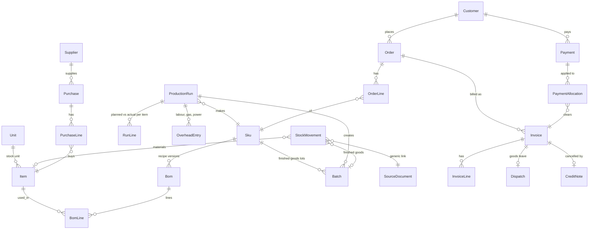

# Design note

Order-to-Audit System. Two pages: data model, how stock and BOM consumption are computed, costing and valuation.

## 1. Principles

1. **The ledger is the truth.** Stock is never a number someone overwrites. Every balance is the sum of an append-only table of movements, each pointing to the document that caused it.
2. **Post through services, never from views.** One function per business event (`issue_material`, `complete_run`, `raise_invoice`, `dispatch_invoice`...), each a single database transaction that writes ledger rows and an audit entry together or not at all.
3. **Exact arithmetic.** `Decimal` throughout; money rounded half-up to the paisa per invoice line; quantities kept to 4 places in the item's own stock unit.
4. **History is immutable.** Invoices, movements and audit entries are never edited or deleted. Mistakes are corrected by a counter-entry: a credit note, a reversal movement, a voided run.

## 2. Data model

`SourceDocument` is not a table: `StockMovement` has a generic foreign key to one of **Purchase, ProductionRun, Dispatch, CreditNote or StockAdjustment**. Every movement therefore traces to a document, and a database check forces finished-goods movements to name a batch and material movements to name none. `AuditLog` (user, time, action, details) hangs off runs, orders, invoices, payments and overheads.

Choices that matter:
- **SKU = product + pack size** (Murukku 200 g, Murukku 500 g). Finished-goods stock, price, HSN and GST rate belong to the SKU; a BOM belongs to a SKU. A new pack size is data, not code.
- **Each item has one stock unit** (flour in kg). Quantities entered in g, L, ml or pieces are converted on entry by a unit table with exact `Decimal` factors; incompatible dimensions are refused. Cartons-of-packets depend on the SKU (`packets_per_carton`), so they are not a generic unit.
- **Invoices copy supplier and buyer details and every line's rate and tax**, so later master-data edits cannot change a posted invoice.

## 3. How stock and BOM consumption are computed

**Balance** = `SUM(qty)` of `StockMovement` for the item (or SKU, or batch). Receipts are positive, issues negative. The stock summary shows *opening + receipts − issues ± adjustments = closing* by classifying movements by type, and a test checks that equation on every row against the ledger.

**A production run** has two stages, because the floor works that way:

1. **Start.** The BOM is scaled to the batch size and **snapshotted** into `RunLine.planned_qty` (flour 40 kg, oil 10 L ...), with expected output `batch_yield × batches`. Later BOM edits cannot rewrite this run.
2. **Issue.** Each raw-material issue posts a negative movement at the item's weighted-average cost and adds to `RunLine.actual_qty`. It is refused if stock is short.
3. **Complete** (one transaction): good packets use pouches (packaging), damaged pouches are written off (wastage), cartons used are consumed, and finished goods are added to a **new batch** (manufacture date, expiry = date + shelf life) at material cost per good packet. If any step fails (say pouches run out) nothing is posted.

**Variance** = (actual − planned) / planned × 100, to 2 places, per item and for yield. A line is **flagged** when it is *adverse* (more material, less yield) and *strictly greater* than the tolerance (3%, or a per-SKU override). A favourable variance beyond tolerance is a *note*. Benchmark: yield 188 vs 200 = −6.00% flagged; oil 10.5 vs 10 = +5.00% flagged; cartons 9 vs 10 = −10.00% noted.

**Dispatch** is first-expiry-first-out: stock is drawn from non-expired batches, earliest expiry first, one movement per batch. Expired stock is never sold and is excluded from the stock check at order approval. **Voiding** a run (or cancelling a dispatched invoice) posts exact opposite movements into the same batches; a void is refused if its batch has already been sold.

**Stock check at approval** shows, per line: stock on sale, packets already promised to other approved orders, packets available, shortage. There is no reservation; stock drops at dispatch.

## 4. Costing and valuation

- **Valuation: weighted average**, replayed from the ledger in time order. A receipt blends into the average (100 kg at ₹42 + 60 kg at ₹45 → ₹43.125); an issue leaves the average unchanged and is posted at the current average. Chosen because it is stable when prices move, needs no cost layers, and is easy to recompute and defend. (FIFO and last-price were considered and not built.)
- **Run cost** = materials and packaging consumed (including damaged pouches, so waste raises the cost of good packets) + overheads.
- **Overhead rule:** labour, gas/power and other costs entered **against a run** are charged to it in full. Costs entered as a **monthly pool** are shared among the runs completed that month **in proportion to good packets** produced, split to the paisa so the shares always add up exactly. A pool in a month with no run is reported as unallocated, not lost.
- **Cost per packet** = run cost / good packets. **Margin** = selling price − cost per packet.
- Benchmark: materials ₹4,055 + labour ₹1,200 + gas/power ₹600 = ₹5,855; ÷ 188 = **₹31.1436**; margin ₹18.86 (37.71%) on ₹50.
- **Known simplification:** finished-goods stock is valued at material cost only, because overheads arrive after the run and the ledger is append-only. The full cost per packet is a costing report, not the stock value.

## 5. Tax and audit

- **GST:** taxable value = quantity × rate. Place of supply (customer's state) against the factory's state decides CGST + SGST (half the rate each) or IGST (whole rate). Numbers are `INV/2026-27/0001`, gap-free per April-March financial year, issued under a row lock.
- **Cancellation** raises a credit note and returns the order to *approved* so a corrected invoice can follow; goods that come back go into the batches they left.
- **Roles are enforced on the server** on every view, not by hiding menu items. The accountant and owner are read-only.
