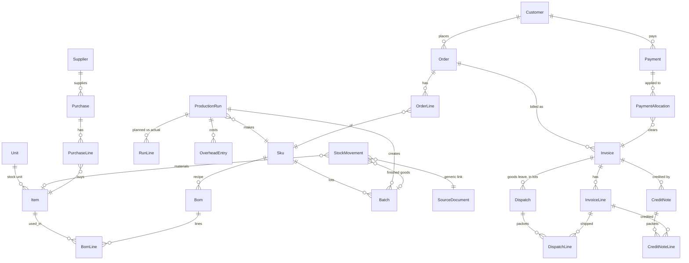

# Design note

Order-to-Audit System: data model, how stock and BOM consumption are computed, costing and valuation.

## 1. Principles

1. **The ledger is the truth.** Stock is never an overwritten number: a balance is the sum of an append-only table of movements, each pointing to the document that caused it.
2. **Business events go through services**, one transaction each (`issue_material`, `complete_run`, `raise_invoice`, `dispatch_invoice`...), writing ledger rows and an audit entry together or not at all.
3. **Exact arithmetic:** `Decimal` throughout; money rounded half-up to the paisa per invoice line; quantities to 4 places in the item's own unit.
4. **History is immutable.** Mistakes are corrected by a counter-entry (credit note, reversal movement, voided run), never by editing.

## 2. Data model

`SourceDocument` is not a table: `StockMovement` has a generic foreign key to a **Purchase, ProductionRun, Dispatch, CreditNote or StockAdjustment**, so every movement traces to a document. A database check requires finished-goods movements to name a batch and material movements not to. `AuditLog` records user, time, action and details for runs, orders, invoices, payments and overheads.

- **SKU = product + pack size** (Murukku 200 g / 500 g). Finished-goods stock, price, HSN, GST rate and BOM belong to the SKU, so a new pack size is data, not code.
- **Each item has one stock unit** (flour in kg). Entries in g, L, ml or pieces are converted with exact `Decimal` factors; incompatible dimensions are refused. Cartons-of-packets depend on the SKU, so they are not a generic unit.
- **Invoices copy** supplier, buyer, rate and tax at posting, so later master-data edits cannot change them.

## 3. How stock and BOM consumption are computed

**Balance** = `SUM(qty)` of movements for the item, SKU or batch (receipts positive, issues negative). The stock summary classifies movements by type to show *opening + receipts − issues ± adjustments = closing*; a test checks that equation on every row against the ledger.

**A production run** is recorded as the floor works, in stages (start, issue as materials are taken, complete):
1. **Start:** the BOM is scaled to the batch size and **snapshotted** into `RunLine.planned_qty` (flour 40 kg, oil 10 L...); expected output = batch yield × batches. Later BOM edits cannot rewrite the run.
2. **Issue:** each raw-material issue posts a negative movement at weighted-average cost and adds to `RunLine.actual_qty`; refused if stock is short.
3. **Complete** (one transaction): good packets use pouches, damaged pouches are written off, cartons are consumed, and finished goods enter a **new batch** (expiry = date + shelf life) at material cost per good packet. If any step fails (say pouches run out), nothing is posted.

**Variance** = (actual − planned) / planned × 100, per item and for yield. **Flagged** when *adverse* (more material, less yield) and *strictly greater* than tolerance (3%, per-SKU override); favourable beyond tolerance is a *note*. Benchmark: yield 188 vs 200 = −6.00% flagged; oil 10.5 vs 10 = +5.00% flagged; cartons 9 vs 10 = −10.00% noted.

**Dispatch is first-expiry-first-out** across non-expired batches, one movement per batch; expired stock is never sold. An invoice may ship in several lots. **Voiding** a run, or returning goods on a credit note (partial or full cancellation), posts exact opposite movements into the same batches; a void is refused if its batch was already sold. **Stock check at approval** shows stock on sale, packets promised to other approved orders, and the shortage. There is no reservation; stock drops at dispatch.

## 4. Costing and valuation

- **Weighted average**, replayed from the ledger in time order: a receipt blends in (100 kg at ₹42 + 60 kg at ₹45 → ₹43.125); an issue leaves the average unchanged. Chosen because it is stable when prices move, needs no cost layers and is easy to recompute and defend. (FIFO and last price were considered, not built.)
- **Run cost** = materials and packaging consumed (damaged pouches included, so waste raises the cost of good packets) + overheads.
- **Overhead rule:** labour, gas/power and other costs entered **against a run** are charged to it in full. A **monthly pool** is shared among the runs completed that month **in proportion to good packets**, split to the paisa so shares sum exactly; a pool in a month with no run is reported as unallocated.
- **Cost per packet** = run cost / good packets; **margin** = price − cost. Benchmark: ₹4,055 + ₹1,200 + ₹600 = ₹5,855 ÷ 188 = **₹31.1436**; margin ₹18.86 (37.71%) on ₹50.
- **Simplification:** finished-goods stock is valued at material cost only (overheads arrive after the run and the ledger is append-only); full cost per packet is a costing-report figure.

## 5. Tax and access

GST: taxable value = quantity × rate; the customer's state against the factory's decides CGST + SGST (half rate each) or IGST. Invoice numbers `INV/2026-27/0001` are gap-free per April-March year, issued under a row lock. Roles are enforced on the server for every view; the accountant and owner are read-only.
